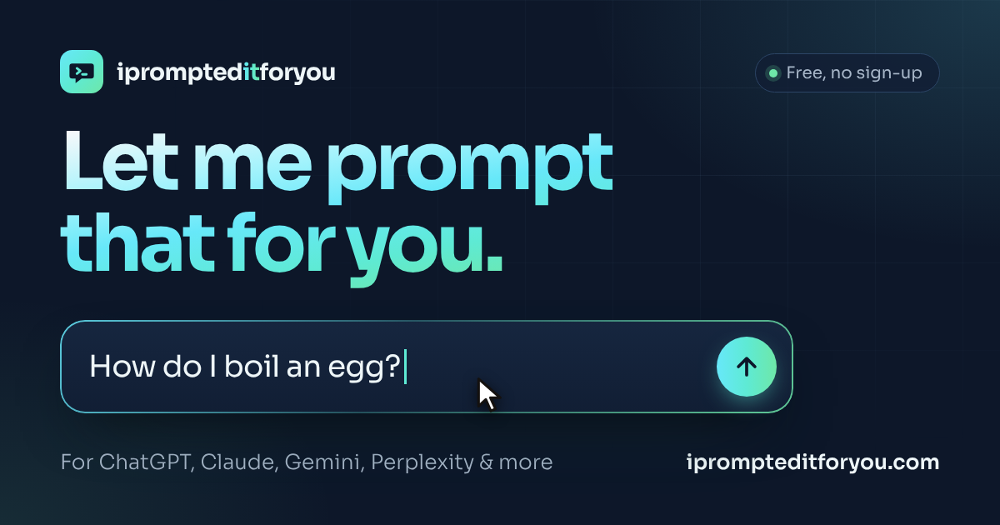

<div align="center">

<a href="https://iprompteditforyou.com">
  
</a>

# I Prompted It For You

**Let me prompt that for you.** Like [LMGTFY](https://letmegooglethat.com), but for AI chats.

Type the question someone asked you, send them the link, and watch them learn how to ask ChatGPT, Claude, Gemini & co. themselves.

[**iprompteditforyou.com**](https://iprompteditforyou.com) · [Docs](docs/) · [Report a bug](https://github.com/0l1v3rr/iprompteditforyou.com/issues/new?template=bug_report.md) · [Request a provider](https://github.com/0l1v3rr/iprompteditforyou.com/issues/new?template=provider_request.md)

[](LICENSE)


</div>

---

## How it works

1. **Type** a question into the big box.
2. **Pick** which AI the link should open in (or let the recipient pick).
3. **Copy** the link and send it.
4. **They open it** and see a cursor glide in, type their question letter by letter, click the AI and land on the answer. *Was that so hard?*

You can also skip the link and open the prompt directly in any supported chat.

## Supported AI chats

| Provider   | `ai=` id     | Prompt pre-filled? |
| ---------- | ------------ | ------------------ |
| ChatGPT    | `chatgpt`    | ✅ |
| Claude     | `claude`     | ✅ |
| Perplexity | `perplexity` | ✅ |
| Grok       | `grok`       | ✅ |
| Copilot    | `copilot`    | ✅ |
| Le Chat    | `lechat`     | ✅ |
| Gemini     | `gemini`     | 📋 copied to clipboard |
| DeepSeek   | `deepseek`   | 📋 copied to clipboard |

Pre-fill parameters are unofficial and can change. See [docs/providers.md](docs/providers.md) to fix or add one.

## Features

- **Zero dependencies, zero build step.** Plain HTML, CSS and ES modules. Deploy the folder as-is.
- **Fast.** No frameworks, no third-party requests. ~16 KB gzipped plus one self-hosted, preloaded variable font (Sora, 33 KB).
- **Private.** Prompts live only inside the link. No backend, no database, no analytics cookies.
- **Accessible.** Semantic landmarks, skip link, labelled controls, live regions, keyboard shortcuts, visible focus and `prefers-reduced-motion` support. Dark theme only, by design.
- **Works without JavaScript.** The form is a real `GET` form: submitting it produces the share link.
- **SEO-ready.** Full meta, Open Graph and Twitter cards, JSON-LD (`WebSite`, `WebApplication`, `FAQPage`), canonical URL, sitemap, robots, `llms.txt`. Shared links are `noindex`.
- **Installable.** Web app manifest with regular and maskable icons.

## Quick start

```bash
git clone https://github.com/0l1v3rr/iprompteditforyou.com.git
cd iprompteditforyou.com
npm run dev        # serves the folder on http://localhost:3000
```

Any static server works (`python3 -m http.server`, `npx serve`, …). ES modules need `http://`, so opening `index.html` from disk won't run the scripts.

```bash
npm install        # only needed for the dev tooling below
npm test           # unit tests for the link format and providers (node:test)
npm run assets     # re-render og-image.png, favicon.ico and app icons
```

## Project structure

```text
.
├── index.html               # The page: markup, meta tags, JSON-LD
├── 404.html
├── assets/
│   ├── css/styles.css       # Design tokens, layout, components (dark only)
│   ├── fonts/               # Sora variable font (OFL)
│   ├── icons/providers/     # One SVG logo per AI chat (drop-in replaceable)
│   └── js/
│       ├── app.js           # Entry: composer, copy/share, provider buttons, boot
│       ├── link.js          # Share-link build/parse + sanitising
│       ├── providers.js     # AI chat registry (add new providers here)
│       └── replay.js        # Recipient animation (lazy-loaded)
├── icons/                   # PWA icons
├── favicon.svg, favicon.ico, apple-touch-icon.png
├── og-image.png             # 1200×630 social card
├── site.webmanifest, robots.txt, sitemap.xml, llms.txt
├── scripts/                 # Asset generation (Playwright + Pillow)
├── tests/                   # node:test unit tests
└── docs/                    # Documentation
```

## Documentation

- [Architecture](docs/architecture.md): how the page is put together and why
- [URL format](docs/url-format.md): the share-link spec
- [Providers](docs/providers.md): adding or fixing an AI chat
- [Deployment](docs/deployment.md): Cloudflare Pages, Netlify, Vercel, GitHub Pages
- [SEO & performance](docs/seo-and-performance.md): what's in place and how to keep it that way

## Contributing

Contributions are welcome: new providers, fixes for broken pre-fill URLs, translations, accessibility improvements. Open an issue to discuss bigger changes first. Keep PRs small, run `npm test`, and check the page on desktop and mobile.

## Inspiration

Standing on the shoulders of [Let Me Google That For You](https://letmegooglethat.com) and [LMGTFY](https://lmgtfy.com), plus earlier AI takes like [letmeaithatforyou.link](https://letmeaithatforyou.link/) and [letmeaithatforyou.dev](https://letmeaithatforyou.dev/).

## Disclaimer

Not affiliated with or endorsed by OpenAI, Anthropic, Google, Perplexity, xAI, Microsoft, Mistral AI or DeepSeek. Product names are trademarks of their respective owners and are used only to identify the services the links open. The files in `assets/icons/providers/` ship as placeholders; if you add official logos, follow each company's brand guidelines.

## License

[MIT](LICENSE) © Oliver Mrakovics
